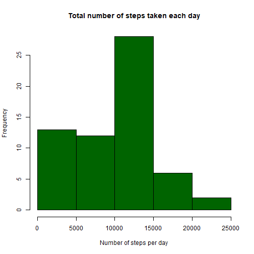
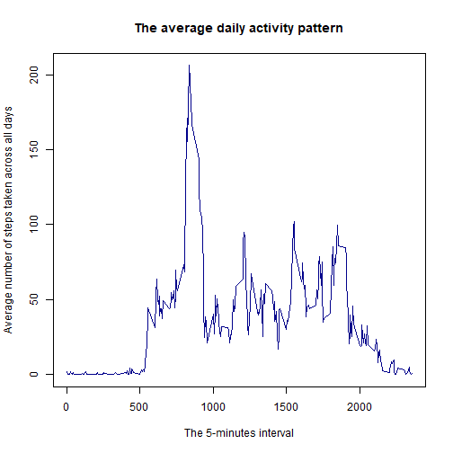
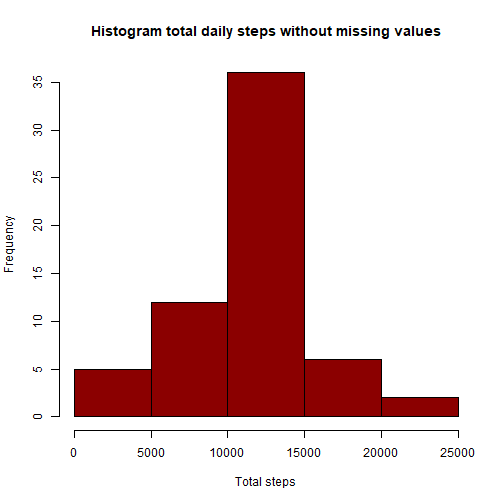
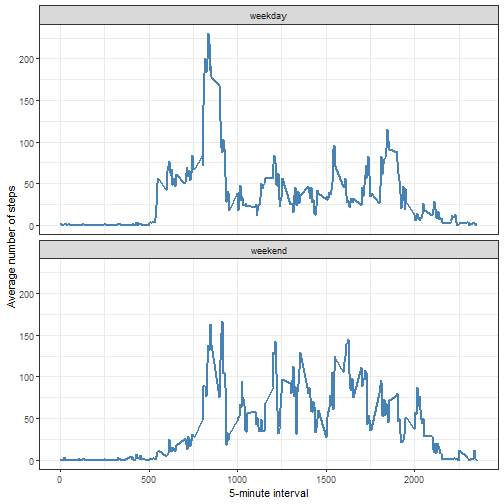

Reproducible Research - Week 2
================================

1.Loading and pre_processing the data


``` r
setwd("D:\\Cousrses\\Data Analysis\\R for Data Analysis\\Peer-graded Assignment Course Project 2.1")
getwd()
```

```
## [1] "D:/Cousrses/Data Analysis/R for Data Analysis/Peer-graded Assignment Course Project 2.1"
```

``` r
activity <- read.csv("activity.csv")
```

Transform date column from char into date


``` r
library(ggplot2)
library(dplyr)
activity <- mutate(activity, date = as.Date(date, "%Y-%m-%d"))
```

2.What is mean total number of steps taken per day?

Calculate the total number of steps taken per day


``` r
totals_daily <- with(activity, tapply(steps, date, sum, na.rm=TRUE))
```

Make a histogram of the total number of steps taken each day


``` r
hist(totals_daily, main = "Total number of steps taken each day", 
     xlab = "Number of steps per day", col = "darkgreen")
```



Calculate and report the mean and median of the total number of steps taken per day


``` r
totals_daily_mean <- format(mean(totals_daily), nsmall = 2)
totals_daily_median <- format(median(totals_daily), nsmall = 2)
```

The daily steps mean is 9354.23 and the daily steps median is 10395.

3.What is the average daily activity pattern?

Make a time series plot


``` r
daily_avg <- with(activity, tapply(steps, interval, mean, na.rm = TRUE))
plot(names(daily_avg), daily_avg, type = "l", col = "darkblue",
     main = "The average daily activity pattern",
     xlab = "The 5-minutes interval",
     ylab = "Average number of steps taken across all days")
```



Which 5-minute interval, on average across all the days in the data set, contains the maximum number of steps?


``` r
max_steps <- activity$interval[which.max(daily_avg)]
```

On average across all days in the data set, the interval 835 contains the maximum number of average steps taken

4.Imputing missing values

Calculate and report the total number of missing values in the data set


``` r
total_na <- sum(is.na(activity))
```

The total NA values in the data set are 2304.

Devise a strategy for filling in all of the missing values in the data set.

Create a new data set that is equal to the original data set but with the missing data filled in.


``` r
activity_filled <- group_by(activity, interval)
activity_filled <- mutate(activity_filled, steps = ifelse(is.na(steps), mean(steps, na.rm = TRUE), steps))
```

Make a histogram of the total number of steps taken each day and Calculate and report the mean and median total number of steps taken per day.


``` r
total_activity_filled <- with(activity_filled, tapply(steps, date, sum, na.rm = TRUE))
hist(total_activity_filled, xlab = "Total steps", col = "darkred",
     main = "Histogram total daily steps without missing values")
```




``` r
filled_daily_mean <- format(mean(total_activity_filled), nsmall = 2)
filled_daily_median <- format(median(total_activity_filled), nsmall = 2)
```

The daily mean steps is 10766.19 steps and the median daily is 10766.19 steps

5.Are there differences in activity patterns between weekdays and weekends?

Create a new factor variable in the data set with two levels – “weekday” and “weekend” indicating whether a given date is a weekday or weekend day.


``` r
activity_filled <- activity_filled %>%
  mutate(
  date,
  day_type = factor(
    ifelse(weekdays(date) %in% c("Saturday", "Sunday"),
             "weekend", "weekday"),
      levels = c("weekday", "weekend"))
  )
```

Make a panel plot containing a time series plot


``` r
ggplot(activity_filled, aes(x = interval, y = steps)) +
  stat_summary(fun = mean, geom = "line", na.rm = TRUE,
               color = "steelblue", linewidth = 1) +
  facet_wrap(~ day_type, ncol = 1) +
  labs(x = "5-minute interval", y = "Average number of steps") +
  theme_bw()
```




